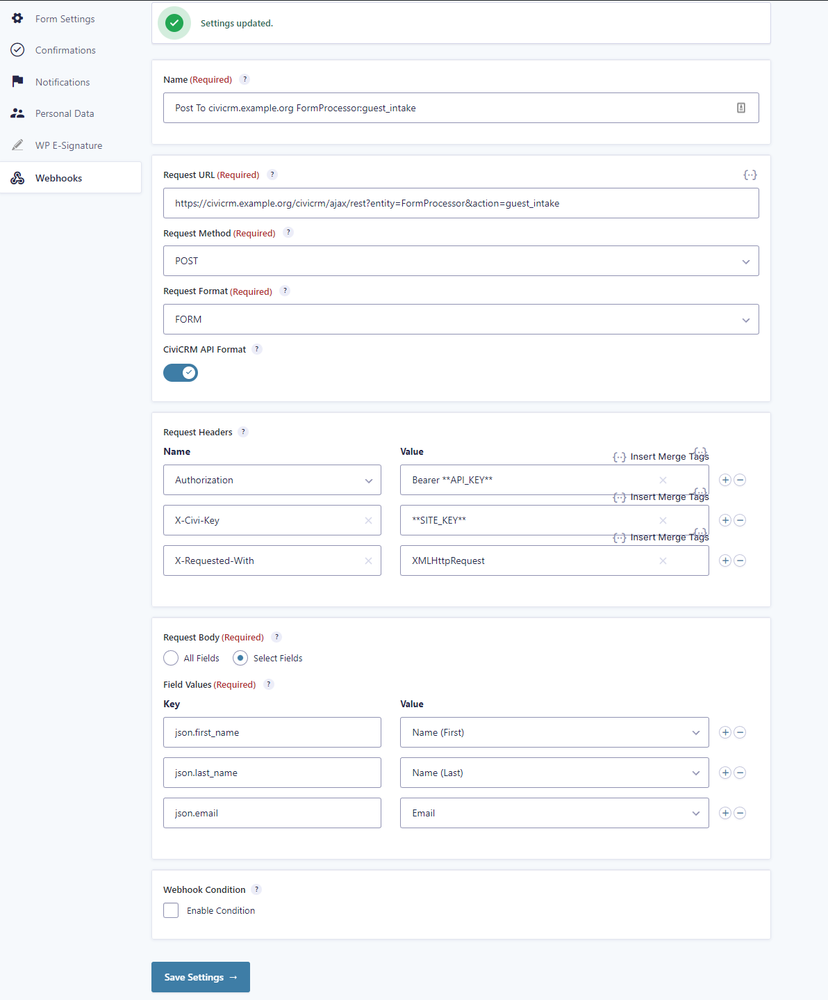
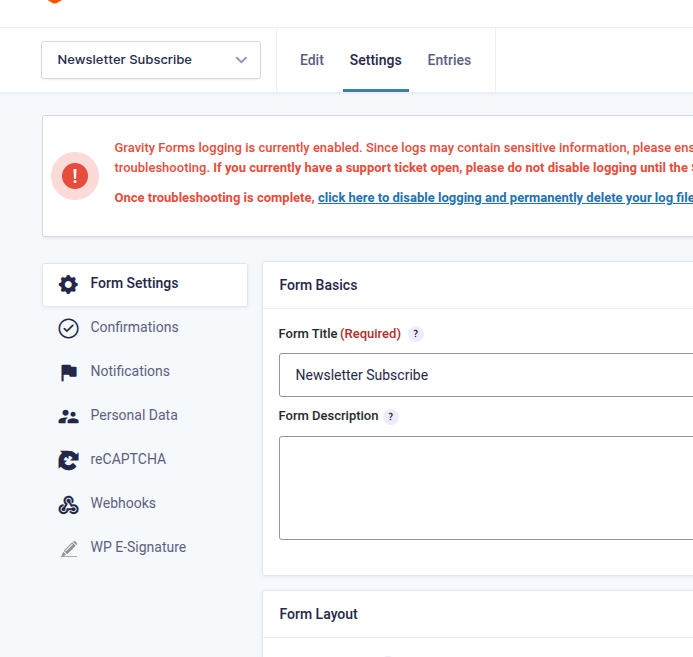
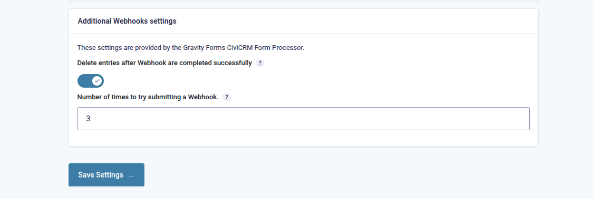

# Gravity Forms CiviCRM Form Processor

Send remote requests to [CiviCRM](https://civicrm.org/) with [Gravity Forms](https://www.gravityforms.com/) [Webhooks](https://www.gravityforms.com/add-ons/webhooks/). This can be done directly to the [CiviCRM API](https://docs.civicrm.org/dev/en/latest/api/) or via [Form Processor](https://lab.civicrm.org/extensions/form-processor).

## What does this extension do?

TL;DR; This extension makes it easier to send data from a Gravity Form to a remote CiviCRM installation.

The CiviCRM REST REST API consumed data via encoded JSON a HTTP form post. In [APIv3](https://docs.civicrm.org/dev/en/latest/api/v3/rest/), this variable is `json`, in [APIv4](https://docs.civicrm.org/dev/en/latest/api/v4/rest/) this variable is `params`. Out of the box, the Gravity Forms Webhooks extension does not support structured JSON or combining data encodings like this (i.e. a Request Format of FORM containing encoded JSON).

This extension also add the option to send an email notification when a webhook to CiviCRM fails.

## How do I get this up and running?

1. (Recommended) Install and configure the [AuthX](https://docs.civicrm.org/dev/en/latest/framework/authx/) extension that comes with CiviCRM. This gives many options for authentication mechanisms.
   1. Configure authentication rules and mechanisms (Administer -> Administration Console -> Authentication). The defaults are probably okay.
2. (Recommended) Install [API Key](https://civicrm.org/extensions/api-key) Extension
3. (Recommended) Install the [Action Provider](https://civicrm.org/extensions/action-provider) and [Form Processor](https://civicrm.org/extensions/form-processor) extensions. These are not necessary, but they do provide quite a bit for flexibility in how data from Gravity Forms is processed compared to directly using the CiviCRM API.
4. Create a new contact to function as the creator of any data coming in from Gravity Forms; there are a [number of ways to authenticate](https://docs.civicrm.org/dev/en/latest/framework/authx/#flows) with this contact. This contact might need an attached user account if the Gravity Forms requests will require specific permissions.
   1. Add an API Key to this contact.
   2. Not the API Key and Site Key (if using Site Key Guard in AuthX)
5. Determine the CiviCRM API end point. There are a number of options: legacy, modern, CMS specific... In this example, we will use the modern ones.
   1. Wordpress
      1. https://civicrm.example.org/civicrm/ajax/rest
      2. https://civicrm.example.org/wp-json/civicrm/v3/rest
      3. https://civicrm.example.org/civicrm/?civiwp=CiviCRM&q=civicrm/ajax/rest
   2. Drupal
      1. https://civicrm.example.org/civicrm/ajax/rest
   3. Joomla
      1. https://civicrm.example.org/index.php?option=com_civicrm&format=raw&task=civicrm/ajax/rest
      2. (with customization) https://civicrm.example.org/civicrm/ajax/rest
         1. To use the clean version of the URL with Joomla, add these likes to the `.htaccess` file user the `` section
         ```
         # Provide a consistant way to access civicrm content
         RewriteCond %{REQUEST_URI} ^/civicrm/(.*)$
         RewriteRule ^(.*)$ index.php?option=com_civicrm&format=raw&task=$1 [QSA]
         ```
6. Create a Gravity Form
7. Go to the Form Settings and add a Webhook
   1. Add the CiviCRM API end point to the Request URL with `entity` (e.g. Contact) and `action` (e.g. create) as query string parameters.
   2. Choose `POST` for the Request Method and `FORM` for the Request Format. 
   3. Enable the CiviCRM API Format
   4. Add Request Headers to provide authentication with CiviCRM. Out of the box, three are necessary with AuthX.
      1. `Authorization: Bearer **API_KEY**`
      2. `X-Civi-Key: **SITE_KEY**`
      3. `X-Requested-With: XMLHttpRequest`
   5. Under the Request Body choose to Select Fields.
      1. Any normal key field will be directly passed to CiviCRM
      2. Any key that needs pass to CiviCRM in the `json` (v3) or `params` (v4) JSON encoded form value, prepend `json.` or `params.` respectively. For example, to send CiviCRM a first name in the request, create the key `json.first_name`.



### Other settings

Two additional helper settings are added to the form settings.



 - **Delete entries after Webhook are completed successfully**: Enabling this setting will delete entries after all Webhooks successfully resolve. Useful for data security.
 - **Number of times to try submitting a Webhook**: By default, Gravity Forms will only attempt to submit a Webhooks one time. This setting will allow a Webhook to be tried multiple times.


## Installing

Requires PHP 8.2 or later, and [Gravity Forms](https://www.gravityforms.com/) with its [Webhooks](https://www.gravityforms.com/add-ons/webhooks/) add-on.

Download `gravityforms-civicrm-form-processor-vX.Y.Z.zip` from the [latest release](https://github.com/blackbricksoftware/gravityforms-civicrm-form-processor/releases/latest) and upload it on **Plugins › Add New › Upload Plugin**. Use that zip, not GitHub's "Source code" archives: those have no `vendor/` folder, so the plugin can't load and does nothing.

The plugin is also on Packagist as `blackbricksoftware/gravityforms-civicrm-form-processor`, for sites managed with composer.

## Updates

New versions are published as GitHub releases, and WordPress offers them on the Plugins page like any other plugin's update. They are never installed on their own unless you turn on auto-updates for this plugin there. WordPress checks a few times a day; **Dashboard › Updates › Check again** checks GitHub straight away. Updates install into whichever folder the plugin is in.

- **Sites where a deploy owns the plugins** (composer, git) should set WordPress's own `define('DISALLOW_FILE_MODS', true);`, which removes the update notice, "Update now" and auto-updates for every plugin. Composer-managed sites update with `composer update blackbricksoftware/gravityforms-civicrm-form-processor`, git checkouts with `git pull` and `composer install --no-dev`.
- **Multisite:** network-activate the plugin, or at least activate it on the main site. WordPress only checks for updates there.
- **What a site must reach:** WordPress asks `api.wordpress.org` about all plugins first, and stops if that fails, before it asks about this one. Then `api.github.com` for the newest release, and `github.com` and `release-assets.githubusercontent.com` to download it. No token is used; the requests carry WordPress's usual user agent, which names the site.
- **What it trusts:** each site installs the zip attached to the repository's latest GitHub release, over HTTPS. Anyone who can publish releases in this repository can therefore ship code to every site with auto-updates on.

**Upgrading from 2.0.0 or earlier** is a manual install, once, since those versions can't update themselves: upload the new release's zip as above. The release zips for 1.0.1–2.0.0 had no folder inside them, so a site that uploaded one has the plugin in a folder named after the zip (`gravity_forms_civicrm_form_processor`, or on WordPress 7.1.4 and later that name plus random characters). The new version's folder is `gravityforms-civicrm-form-processor`, so WordPress installs it beside the old copy instead of replacing it, and the Plugins page lists the plugin twice, as version v2.0.0 and the new version. Activate the new copy first, then deactivate and delete the v2.0.0 one, so there's no moment with neither running (both active at once is harmless). Nothing is lost: the plugin's form and webhook settings are stored by Gravity Forms. Composer and git installs update as above instead.

## Releasing

1. Set the version in the plugin header, `Version: X.Y.Z`, with no `v` (WordPress compares it as written, and PHP sorts `v2.1.0` below `2.1.0`).
2. Add a `# vX.Y.Z (YYYY-MM-DD)` entry at the top of `CHANGELOG.md`. It becomes the release notes.
3. Commit, then tag and push: `git tag vX.Y.Z && git push origin vX.Y.Z`. Tag only commits that have `.github/workflows/build.yml`; a tag on a commit from before 2.1.0 runs that commit's old workflow.

The [Build workflow](.github/workflows/build.yml) builds the zip, tests it in a throwaway WordPress, and publishes that same zip to the tag's GitHub release. It refuses to build if the header, the changelog and the tag disagree, and refuses to replace the zip of a release that is already published. Sites see the release once GitHub marks it Latest, which the workflow does unless a higher tag exists.

Raising **Requires PHP** isn't enforced for sites that update in place: the update WordPress is offered carries no PHP requirement, so the auto-updater installs it on an older PHP. Only uploads, activation and "Update now" on the Plugins page check the new header.

To build locally: `bin/build.sh` (needs PHP 8.2, composer and zip) writes `dist/gravityforms-civicrm-form-processor-vX.Y.Z.zip`. To test: `tests/run.sh` (needs PHP with pdo_sqlite, WP-CLI, curl, unzip, zip, perl and composer) builds the zip itself, replacing `dist/`, installs it in a WordPress downloaded into `.sandbox/`, and tests the updates end to end. `GFCFP_TEST_ZIP=path/to.zip tests/run.sh` tests a zip you already have.
